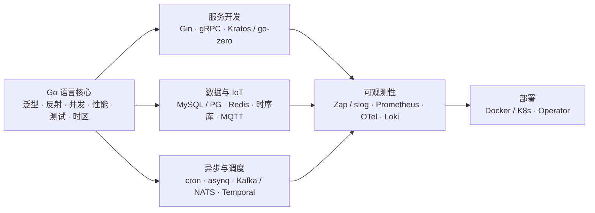

<div align="center">

# open-guide

**Go 后端技术栈中文深度指南合集**

能读、能查、能直接抄代码的「技术手册」，而不是又一份 Hello World。

[](./README.md)
[](./README.md)
[](./README.md)

[](./LICENSE)
[](https://weisg1999.github.io/open-guide/)
[](./.github/workflows/check-html.yml)
[](https://github.com/Weisg1999/open-guide/commits/main)
[](https://go.dev)
[](./README_EN.md)

[在线浏览](https://weisg1999.github.io/open-guide/) · [文档目录](#二文档目录) · [阅读路径](#三推荐的阅读路径) · [快速开始](#四两种阅读方式) · [写作规范](#五每篇文档的必备要素) · [贡献](#七贡献)

</div>

---

<div align="center">

| 📚 指南 | 📝 正文 | 📄 离线手册 | 🖼️ 架构图 | ✅ 写作规范 | ⚖️ 许可 |
| :---: | :---: | :---: | :---: | :---: | :---: |
| **66 篇** | **≈ 31,578 行** | **66 份** | **117 张 SVG** | **7 个必备要素** | **MIT** |

</div>

---

## 一、这是什么

`open-guide` 是一个**纯文档仓库**，收录 Go 后端开发中最常用、最容易踩坑的一批开源项目与语言特性。每一篇都不是对官方 README 的机翻，而是按同一套结构重写的深度指南：

<div align="center">

`定位` → `能力清单` → `原理` → `实战` → `版本` → `坑` → `选型`

</div>

| 🎯 真实痛点 | ✅ 本仓库的做法 |
| --- | --- |
| 官方文档散、旧、只有 API 列表 | 按「原理 → 代码 → 坑 → 选型」重组，一篇读完能上手 |
| 博客文章版本过时、结论不敢用 | 每篇文首标注**对应的上游版本与发布时间**，结论可溯源 |
| 只有用法，不知道为什么 | 每个特性都配原理说明（etcd 的 Raft/MVCC、asynq 的 Redis 数据结构、泛型 GC Shape、ClickHouse 的 MergeTree） |

**这份仓库适合谁**

| 你是 | 能拿到什么 |
| --- | --- |
| 刚转 Go、补语言基础 | 语言核心 9 篇：泛型 → 反射 → 并发 → 性能 → 测试 → 时区，每篇都有可运行代码 |
| 正在做技术选型 | 每篇末尾的横向选型对比；消息、数据库、可观测三组还有跨篇对照 |
| 线上排障、复盘 | 直接跳每篇的「常见坑」；可观测性 6 篇给出日志 / 指标 / 链路的分工 |
| 要写团队内部规范 | 7 要素模板 + 构建脚本，fork 后替换主题即可得到自己的手册 |

> 仓库中**不包含任何第三方源码**，只做整理、讲解与二次组织；所有版权归各自上游项目所有（详见 [声明](#八许可证与声明)）。

---

## 二、文档目录

<div align="center">

| 🔤 语言核心 | 🌐 服务与治理 | 🗄️ 数据存储与检索 | 📨 消息 / 任务 | 🔭 可观测性 | 🐳 部署 |
| :---: | :---: | :---: | :---: | :---: | :---: |
| **13** | **12** | **21** | **8** | **7** | **5** |

</div>

每篇都提供 `MD`（便于搜索、复制、提 PR）与 `HTML`（零依赖单文件离线手册）两种格式。

### 🔤 Go 语言核心 <sub>13 篇</sub>

| 主题 | 覆盖要点 | 文档 |
| --- | --- | --- |
| **Go 泛型** | 类型参数、约束（constraint）、泛型类型与方法、GC Shape Stenciling 实现原理、泛型的能力边界与坑、实战：类型安全通用缓存 | [MD](./go-generics/go-generics-tutorial.md) · [HTML](./go-generics/go-generics-tutorial.html) |
| **Go 反射** | 反射三定律、`reflect.Type` / `reflect.Value`、动态调用与修改、结构体 Tag 深入（`encoding/json` / ORM 原理）、性能代价、反射 vs 泛型怎么选 | [MD](./go-reflection/go-reflection-tutorial.md) · [HTML](./go-reflection/go-reflection-tutorial.html) |
| **Go 并发与 Context** | GMP 调度、channel 内部结构与 select、context 取消树、happens-before 与 atomic、errgroup / singleflight、goroutine 泄漏排查 | [MD](./go-concurrency/go-concurrency-guide.md) · [HTML](./go-concurrency/go-concurrency-guide.html) |
| **Go 性能剖析** | pprof 五类 profile、逃逸分析、GC 与 GOGC / GOMEMLIMIT、`go tool trace`、benchmark 与 benchstat、PGO | [MD](./go-perf/go-perf-guide.md) · [HTML](./go-perf/go-perf-guide.html) |
| **Go 测试与可测性** | 表驱动与 `t.Run`、`t.Parallel` 循环变量、httptest、fake / stub / mock、sqlmock、testcontainers、fuzz、race 与覆盖率口径 | [MD](./go-testing/go-testing-guide.md) · [HTML](./go-testing/go-testing-guide.html) |
| **时区与时间处理** | 时刻 vs 墙上时间、`time.Time` 内部表示、IANA tzdata 与容器缺库、DST 不存在/重复的钟点、DB 时区语义、跨时区调度与日切统计 | [MD](./go-time/go-time-guide.md) · [HTML](./go-time/go-time-guide.html) |
| **Go 1.2x 现代特性** | 1.22 循环变量语义、range-over-func 与 `iter`、泛型类型别名、`unique` / `weak`、slices / maps / slog、toolchain 与 PGO | [MD](./go-modern/go-modern-guide.md) · [HTML](./go-modern/go-modern-guide.html) |
| **samber/lo** | 基于泛型的 Lodash 风格工具库：slice / map / channel / string / 函数式helper 全量分类讲解，与标准库 `slices`/`maps` 的关系 | [MD](./samber-lo/samber-lo-guide.md) · [HTML](./samber-lo/samber-lo-guide.html) |
| **Cobra / sqlc** | 命令树与 `RunE`、`PersistentFlags` vs `LocalFlags`、与 Viper 绑定、sqlc 编译模型与查询注解、NULL 类型映射、goose 迁移配合 | [MD](./cobra-sqlc/cobra-sqlc-guide.md) · [HTML](./cobra-sqlc/cobra-sqlc-guide.html) |
| **ants** | goroutine 池的调度模型、cap 与队列语义、阻塞 / 非阻塞两种失败模式、`Invoke` 与超时、panic 处理、Running / Free / Waiting 指标 | [MD](./ants/ants-guide.md) · [HTML](./ants/ants-guide.html) |
| **google/wire** | 编译期依赖注入、Provider / ProviderSet、`wire.Bind` / `Struct` / `Value`、cleanup 顺序、类型唯一性、与 fx / dig 的取舍 | [MD](./wire/wire-guide.md) · [HTML](./wire/wire-guide.html) |
| **Excelize** | OOXML 结构、共享字符串表的内存账、普通 API vs `StreamWriter`、样式共享池、迭代读取、十万行导出与模板填充 | [MD](./excelize/excelize-guide.md) · [HTML](./excelize/excelize-guide.html) |
| **Go 设计模式** | 哪些 GoF 模式在 Go 里消失 / 变形、functional options、中间件链、策略 = 函数值、观察者 = channel、并发模式与设计模式的区别、何时不该用 | [MD](./golang-design-pattern/golang-design-pattern-guide.md) · [HTML](./golang-design-pattern/golang-design-pattern-guide.html) |

### 🌐 Web、微服务与治理 <sub>12 篇</sub>

| 主题 | 覆盖要点 | 文档 |
| --- | --- | --- |
| **Gin** | 基数树路由、中间件链、参数绑定与校验、响应渲染、优雅启停，v1.10 → v1.12 演进 | [MD](./gin/gin-guide.md) · [HTML](./gin/gin-guide.html) |
| **Kratos**（Bilibili） | API-first / Protobuf 驱动、HTTP + gRPC 双协议统一、可插拔组件（registry / config / log / middleware），v3.0 要点与 v2 迁移 | [MD](./kratos/kratos-guide.md) · [HTML](./kratos/kratos-guide.html) |
| **go-zero**（好未来） | `.api` DSL + `goctl` 代码生成、自适应熔断 / 限流 / 负载卸载、web 与 rpc 一体 | [MD](./go-zero/go-zero-guide.md) · [HTML](./go-zero/go-zero-guide.html) |
| **gRPC-Go** | HTTP/2 多路复用与 Protobuf 编码、`.proto` 契约与代码生成、四种流模式、拦截器链、deadline 跨进程传播、resolver/balancer | [MD](./grpc/grpc-guide.md) · [HTML](./grpc/grpc-guide.html) |
| **Viper** | 配置优先级链（Set / flag / env / 文件 / 远程 KV / 默认值）、`AutomaticEnv` 与 key replacer、`Unmarshal` + mapstructure、`WatchConfig` 热更新、并发与零值陷阱 | [MD](./viper/viper-guide.md) · [HTML](./viper/viper-guide.html) |
| **Casbin** | PERM 元模型与求值过程、ACL / RBAC / ABAC / RESTful、`g` 角色继承与多租户 domain、Adapter 与 Watcher 策略同步、Enforcer 并发与缓存、与 OPA 的边界 | [MD](./casbin/casbin-guide.md) · [HTML](./casbin/casbin-guide.html) |
| **认证：JWT / OAuth2 / OIDC** | JWT 结构与签名算法、校验清单（alg 白名单 / iss / aud / exp）、JWKS 轮换、OAuth2 四种模式与 PKCE、OIDC、refresh 轮换与撤销 | [MD](./auth/auth-guide.md) · [HTML](./auth/auth-guide.html) |
| **服务治理** | 限流四算法、单机 vs 集群限流、熔断三态与滑动窗口、自适应限流、重试预算与幂等、舱壁隔离、降级形态 | [MD](./service-governance/service-governance-guide.md) · [HTML](./service-governance/service-governance-guide.html) |
| **gorilla/websocket** | 握手与 Origin 校验、帧与消息、单 reader / 单 writer 模型、deadline 与心跳、关闭握手、读上限与背压、水平扩展 | [MD](./websocket/websocket-guide.md) · [HTML](./websocket/websocket-guide.html) |
| **Sentinel-Go** | 资源与 Entry 生命周期、LeapArray 滑动窗口、快速失败 / Warm Up / 匀速排队、慢调用与异常比例熔断、热点参数限流、规则推送到 etcd / Nacos、与 Gin / gRPC 中间件集成 | [MD](./sentinel/sentinel-guide.md) · [HTML](./sentinel/sentinel-guide.html) |
| **GraphQL（gqlgen）** | Schema first 与代码生成、字段级 Resolver 执行模型、N+1 与 DataLoader、Relay 游标分页、错误 extensions、订阅与 graphql-ws、深度与复杂度限制 | [MD](./graphql/graphql-guide.md) · [HTML](./graphql/graphql-guide.html) |
| **Go 工程分层** | 依赖倒置与接口归属、domain / application / infrastructure / interface 四层职责、贫血模型与不变量、仓储边界、事务放在用例层、模块化单体与 internal 约束 | [MD](./architecture/architecture-guide.md) · [HTML](./architecture/architecture-guide.html) |

### 🗄️ 数据存储与检索 <sub>21 篇</sub>

| 主题 | 覆盖要点 | 文档 |
| --- | --- | --- |
| **MySQL** | B+ 树聚簇索引与回表、最左前缀与覆盖索引、MVCC / ReadView 与隔离级别、临键锁与死锁、`EXPLAIN` 慢查询、主从复制与延迟、`database/sql` 连接池 | [MD](./mysql/mysql-guide.md) · [HTML](./mysql/mysql-guide.html) |
| **PostgreSQL** | 元组多版本 MVCC 与 VACUUM、默认 READ COMMITTED 与 SSI、B-tree / GIN / GiST / BRIN 索引、`jsonb` 与 GIN、WAL 逻辑复制、pgx v5 连接池与 `CopyFrom`、SQLSTATE 重试 | [MD](./postgresql/postgresql-guide.md) · [HTML](./postgresql/postgresql-guide.html) |
| **分布式事务** | 2PC / XA 的代价、TCC 空回滚与悬挂、Saga 编排与补偿、Outbox 发件箱、事务消息、幂等与对账 | [MD](./distributed-transaction/distributed-transaction-guide.md) · [HTML](./distributed-transaction/distributed-transaction-guide.html) |
| **DTM** | Saga 正序补偿逆序、TCC 三接口与空回滚 / 悬挂、子事务屏障、二阶段消息、XA 边界、工作流编排 | [MD](./dtm/dtm-guide.md) · [HTML](./dtm/dtm-guide.html) |
| **GORM** | 链式 API、关联与预加载、事务与 SavePoint、Hook、迁移器、软删除、读写分离插件、泛型接口 | [MD](./gorm/gorm-guide.md) · [HTML](./gorm/gorm-guide.html) |
| **go-redis** | 连接池与 `Cmdable`、Pipeline vs TxPipeline、`redis.Nil` 语义、Lua 与分布式锁、Stream 消费组、Cluster slot 与 hash tag、缓存三件套 | [MD](./redis/redis-guide.md) · [HTML](./redis/redis-guide.html) |
| **etcd** | Raft 共识、MVCC 多版本、bbolt B+ 树、Lease / Watch / 分布式锁、clientv3 实战、v3.6 要点 | [MD](./etcd/etcd-guide.md) · [HTML](./etcd/etcd-guide.html) |
| **InfluxDB 2.x** | Bucket / Token 模型、TSM 存储引擎、Flux 查询、任务与告警、Go 客户端写入查询 | [MD](./influxdb-v2/influxdb-v2-guide.md) · [HTML](./influxdb-v2/influxdb-v2-guide.html) |
| **InfluxDB 3** | Rust 重写的 FDAP 栈（Flight + DataFusion + Arrow + Parquet）、SQL 查询、对象存储优先、无限基数、Core vs Enterprise 选型 | [MD](./influxdb-v3/influxdb-v3-guide.md) · [HTML](./influxdb-v3/influxdb-v3-guide.html) |
| **MinIO** | S3 兼容对象存储、纠删码、Bucket / Object 模型、分片上传、预签名 URL、2025 起产品线变化 | [MD](./minio/minio-guide.md) · [HTML](./minio/minio-guide.html) |
| **Elasticsearch** | 倒排索引与 `text`/`keyword`、分析器与 IK 中文分词、NRT refresh 与 segment merge、分片路由与 BM25、Bool Query DSL 与聚合、`search_after` + PIT、Alias/Rollover/ILM 时序索引 | [MD](./elasticsearch/elasticsearch-guide.md) · [HTML](./elasticsearch/elasticsearch-guide.html) |
| **MongoDB** | BSON 文档模型与 `bson.D` 顺序、WiredTiger 文档级并发、副本集与 oplog、片键三要素与分片路由、聚合管道与 ESR 索引、事务与 Change Streams | [MD](./mongodb/mongodb-guide.md) · [HTML](./mongodb/mongodb-guide.html) |
| **ClickHouse** | MergeTree part 与后台合并、稀疏主键索引与数据跳过索引、ORDER BY 设计、向量化执行、物化视图预聚合、`PrepareBatch` 批量写、ReplacingMergeTree 最终一致去重、与 InfluxDB 3 的 FDAP 对照 | [MD](./clickhouse/clickhouse-guide.md) · [HTML](./clickhouse/clickhouse-guide.html) |
| **OpenSearch** | 从 ES 7.10 分叉与 Apache-2.0 许可、Lucene 倒排与 NRT、分片路由、k-NN 向量检索、ISM 与 Data Streams、opensearch-go 客户端、与 ES 的兼容边界 | [MD](./opensearch/opensearch-guide.md) · [HTML](./opensearch/opensearch-guide.html) |
| **TimescaleDB** | hypertable 与 chunk 自动分区、`time_bucket`、连续聚合、列式压缩与 segmentby / orderby、retention 与数据分层、唯一索引必须含时间列、与 InfluxDB / ClickHouse 的边界 | [MD](./timescaledb/timescaledb-guide.md) · [HTML](./timescaledb/timescaledb-guide.html) |
| **向量数据库** | 距离度量与归一化、HNSW 的 M / efConstruction / efSearch、IVF / PQ、pre-filter vs post-filter、RRF 混合检索、pgvector / Milvus / Qdrant 实战 | [MD](./vector-database/vector-database-guide.md) · [HTML](./vector-database/vector-database-guide.html) |
| **golang-migrate** | 版本表与 dirty 语义、up / down / steps、`embed` + `iofs`、并发与 advisory lock、不可逆迁移、与 goose / atlas 的分工 | [MD](./migrate/migrate-guide.md) · [HTML](./migrate/migrate-guide.html) |
| **CDC（Debezium / Canal）** | binlog row 模式、快照与增量衔接（GTID / file+pos）、Debezium 事件信封、Canal 伪装从库、outbox 路由、schema 演进、延迟与积压监控、大事务与位点失效 | [MD](./cdc/cdc-guide.md) · [HTML](./cdc/cdc-guide.html) |
| **分库分表** | 垂直与水平拆分、分片键与基因法、取模 / 范围 / 一致性哈希路由、跨片查询三种解法、双写迁移与翻倍扩容、ShardingSphere-Proxy 与 Vitess | [MD](./sharding/sharding-guide.md) · [HTML](./sharding/sharding-guide.html) |
| **本地缓存** | TinyLFU 与 LRU 的差别、bigcache 分片与免 GC、freecache 堆外内存、singleflight 防击穿、二级缓存失效顺序、多实例广播失效 | [MD](./local-cache/local-cache-guide.md) · [HTML](./local-cache/local-cache-guide.html) |
| **分布式 ID** | 雪花结构与时钟回拨、机器号分配（etcd 注册）、号段双 buffer、UUIDv7 与 B+ 树插入、基因法、int64 精度与不可预测性 | [MD](./distributed-id/distributed-id-guide.md) · [HTML](./distributed-id/distributed-id-guide.html) |

> 💡 ES 有双重身份：业务全文检索与日志检索。日志场景可与 [Zap 篇](./zap/zap-guide.md) 的 `trace_id` 配合，直接跳到 [OpenTelemetry](./opentelemetry/opentelemetry-guide.md) 链路。

### 📨 消息、任务与调度 <sub>8 篇</sub>

| 主题 | 覆盖要点 | 文档 |
| --- | --- | --- |
| **asynq** ⭐ | 本仓库最完整的一篇（1300+ 行）。Redis 分布式任务队列：任务生命周期、延时/重试/死信、优先级与加权队列、任务去重、任务聚合、超时与截止、Prometheus 指标、Asynqmon Web UI 部署 | [MD](./asynq/asynq技术文档与使用手册.md) · [HTML](./asynq/asynq技术文档与使用手册.html) |
| **Apache Kafka** | 分区与副本、消费者组与 offset、ISR 与 ACK 语义、Go 客户端（segmentio/kafka-go）实战、Kafka 4.x 移除 ZooKeeper | [MD](./kafka/kafka-guide.md) · [HTML](./kafka/kafka-guide.html) |
| **NATS / JetStream** | Subject 寻址、发布订阅与请求响应、队列组、JetStream 持久化流与消费者、nats.go 实战 | [MD](./nats/nats-guide.md) · [HTML](./nats/nats-guide.html) |
| **MQTT / EMQX** | 报文与连接生命周期、QoS 0/1/2 握手、会话与 Session Expiry、retained 与遗嘱、共享订阅、paho 实战、EMQX 6.x 与 BSL 许可 | [MD](./mqtt/mqtt-guide.md) · [HTML](./mqtt/mqtt-guide.html) |
| **robfig/cron** | 标准 5 字段 / 6 字段 cron 表达式、标准解析器扩展（`@every` / `@daily`）、Job 包装器（`SkipIfStillRunning` 等）、时区与并发、自定义 Job | [MD](./robfig-cron/robfig-cron-guide.md) · [HTML](./robfig-cron/robfig-cron-guide.html) |
| **RabbitMQ / RocketMQ** | Exchange/Queue 路由模型、Publisher Confirm 与手动 ACK、Quorum Queue 与 DLX、CommitLog 顺序写、顺序/事务/定时消息、at-least-once 幂等消费、与 Kafka / NATS / asynq 的边界 | [MD](./rabbitmq/rabbitmq-guide.md) · [HTML](./rabbitmq/rabbitmq-guide.html) |
| **Temporal** | Durable Execution 与事件历史重放、确定性约束、持久计时器、Activity 幂等与重试分层、Signal / Query / Update、Saga 补偿、`GetVersion` 与 `Continue-As-New`、WorkflowReplayer 测试 | [MD](./temporal/temporal-guide.md) · [HTML](./temporal/temporal-guide.html) |
| **Watermill** | Publisher / Subscriber 抽象、Router 与 ack 时机、中间件链（Recoverer / Retry / PoisonQueue）、CQRS、至少一次语义下的幂等 | [MD](./watermill/watermill-guide.md) · [HTML](./watermill/watermill-guide.html) |

> 💡 五篇消息 / 任务文档（Kafka / NATS / asynq / RabbitMQ·RocketMQ / Temporal）末尾都有**横向选型对比表**，可直接用来做技术选型。

### 🔭 可观测性 <sub>7 篇</sub>

| 主题 | 覆盖要点 | 文档 |
| --- | --- | --- |
| **Zap** | 零分配热路径与强类型 Field、`Logger` vs `SugaredLogger`、`zapcore` 四层管线（Encoder / WriteSyncer / LevelEnabler）、Tee 多目的地分流、采样与 `AtomicLevel`、与标准库 `log/slog` 的关系 | [MD](./zap/zap-guide.md) · [HTML](./zap/zap-guide.html) |
| **log/slog** | 标准库结构化日志实践：Logger / Handler / Record / Attr 四层抽象、`LevelVar` 动态调级、自定义 ContextHandler 注入 `trace_id`、`ReplaceAttr` 脱敏、Fanout 多输出、与 Zap / OTel 桥接 | [MD](./slog/slog-guide.md) · [HTML](./slog/slog-guide.html) |
| **Prometheus** | 拉取模型与多维标签时序、四种指标类型与 `rate()`、TSDB 倒排索引、PromQL / 记录规则 / Alertmanager、高基数陷阱、与 InfluxDB 和 OTel Metrics 的边界 | [MD](./prometheus/prometheus-guide.md) · [HTML](./prometheus/prometheus-guide.html) |
| **OpenTelemetry** | Trace/Span 模型与 W3C `traceparent` 传播、Sampler / BatchSpanProcessor / OTLP、Resource 与语义约定、Gin/gRPC/asynq 埋点、把 `trace_id` 写进 Zap 日志 | [MD](./opentelemetry/opentelemetry-guide.md) · [HTML](./opentelemetry/opentelemetry-guide.html) |
| **Grafana Loki** | 只索引标签、不索引正文的成本模型、chunk + TSDB 索引与对象存储、Distributor/Ingester/Querier 路径、LogQL 两段式与解析器、高基数禁忌、compactor 与 retention、Alloy 采集 | [MD](./loki/loki-guide.md) · [HTML](./loki/loki-guide.html) |
| **VictoriaMetrics / Thanos** | Prometheus 本地 TSDB 的保留期与单机瓶颈、VM 单机与集群版（vminsert / vmselect / vmstorage）、MetricsQL、Thanos Sidecar / Store / Query / Compactor、对象存储降采样与副本去重、两条路线怎么选 | [MD](./victoriametrics/victoriametrics-guide.md) · [HTML](./victoriametrics/victoriametrics-guide.html) |
| **Nightingale（夜莺）** | 告警控制面定位、业务组 / 机器 / 标签模型、`rule_config` 与 `cron_pattern`、告警引擎分片与心跳、屏蔽 / 订阅 / 通知链、事件管道、v9 内置 TSDB 与 AI / MCP | [MD](./nightingale/nightingale-guide.md) · [HTML](./nightingale/nightingale-guide.html) |

> 💡 `Zap` / `slog` 管日志输出、`Loki` 管日志检索、`Prometheus` 管指标、`OpenTelemetry` 管链路，靠统一的 `service.name` 与 `trace_id` 串成完整排障链路。

### 🐳 部署与编排 <sub>5 篇</sub>

| 主题 | 覆盖要点 | 文档 |
| --- | --- | --- |
| **Docker / Kubernetes** | 镜像分层与多阶段构建、namespace/cgroups、声明式 Reconcile Loop、Pod/Deployment/Service、三类探针与 QoS、滚动发布与优雅下线、client-go 与 RBAC | [MD](./docker-k8s/docker-k8s-guide.md) · [HTML](./docker-k8s/docker-k8s-guide.html) |
| **Kubernetes Operator** | 声明式协调与 level-triggered、CRD / Scheme、Reconcile 幂等、resourceVersion 冲突、ownerReference 与 finalizer、envtest 与 e2e | [MD](./k8s-operator/k8s-operator-guide.md) · [HTML](./k8s-operator/k8s-operator-guide.html) |
| **Helm** | Chart 目录与四类文件、`.Values` / `.Release` / `.Capabilities` 上下文、values 合并与 `--set` 类型陷阱、`_helpers.tpl`、Hooks 与执行时机、依赖开关、helm diff / rollback、helm-unittest | [MD](./helm/helm-guide.md) · [HTML](./helm/helm-guide.html) |
| **ArgoCD** | GitOps 控制循环、Application / AppProject / ApplicationSet、selfHeal 与 prune、Sync Waves 与钩子、多集群、SOPS / Sealed Secrets、漂移检测与回滚 | [MD](./argocd/argocd-guide.md) · [HTML](./argocd/argocd-guide.html) |
| **发布策略** | 蓝绿 / 金丝雀 / A-B / 流量镜像、Ingress 注解与 APISIX traffic-split、Argo Rollouts 自动判定、流量染色透传、数据库 expand-contract、灰度期缓存与 MQ 的坑 | [MD](./release-strategy/release-strategy-guide.md) · [HTML](./release-strategy/release-strategy-guide.html) |

---

## 三、推荐的阅读路径

先看整体形状：所有方向都建立在 Go 语言核心之上，最后都落到可观测性与部署。



<div align="center">

| 🧱 服务开发方向 | 💾 数据 / IoT 方向 | ⚡ 异步与调度方向 |
| :---: | :---: | :---: |
| `Gin` → `gRPC` → `Viper` / `Casbin` | `MySQL` / `PostgreSQL` | `robfig/cron` |
| `Kratos` · `go-zero` → `etcd` | `GORM` → `go-redis` | `asynq` |
| `ES` / `OpenSearch` · `MongoDB`（检索 / 文档） | `InfluxDB` / `TimescaleDB` → `MinIO` → `ClickHouse` | `Kafka` · `NATS` · `RabbitMQ` → `Temporal` |

**共同基座**　`Go 泛型` → `Go 反射` → `Go 并发` → `Go 性能剖析` → `Go 测试` → `samber/lo`　·　`Zap` / `slog` · `Prometheus` · `VictoriaMetrics / Thanos` · `OpenTelemetry` · `Loki`　·　`Docker / K8s`

</div>

> 🔭 **横切全路径**：`gRPC` 属「服务开发方向」的通信层，`Viper` / `Casbin` 是其配置与授权底座；`MySQL` / `PostgreSQL` / `TimescaleDB` / `go-redis` / `ClickHouse` 属数据方向（OLTP → 时序 → KV → OLAP），`Elasticsearch` / `OpenSearch` / `MongoDB` 是检索与文档支线；`RabbitMQ / RocketMQ` / `Temporal` 属异步与调度方向；`Zap` / `slog` / `Prometheus` / `VictoriaMetrics · Thanos` / `OpenTelemetry` / `Loki` 是三条路径共用的可观测性基座；`Docker / K8s` 是所有篇目最后都要落到的部署层。

| 你的目标 | 建议顺序 |
| --- | --- |
| 打牢 Go 基本功 | 泛型 → 反射 → **并发与 Context** → **性能剖析** → samber/lo |
| 要给服务加登录 | **认证：JWT / OAuth2 / OIDC** → 校验清单先行，权限交给 Casbin |
| 要扩展 K8s API | **Kubernetes Operator** → CRD + Reconcile，先确认 Helm 是否够用 |
| 写命令行工具 / 想要类型安全 SQL | **Cobra / sqlc** → 命令树 + SQL 生成，别手写字符串拼接 |
| 准备升级 Go 版本 | **Go 1.2x 现代特性** → 先读行为变化，再逐 minor 升级 |
| 要交付可维护的代码 | **Go 测试与可测性** → 表驱动 → httptest → testcontainers |
| 做跨国 / 双时区业务 | **时区与时间处理** → 统一存 UTC、展示按目标时区，DST 要测 |
| 依赖不稳定 / 流量突增 | **服务治理** → 限流 → 熔断 → 重试预算，超时先行 |
| 多时序库统一告警 | **Nightingale** → 规则与通知收口，值班升级另接 PagerDuty / FlashDuty |
| 做实时推送 | **gorilla/websocket** → 单写者模型 + 心跳，集群广播走 NATS |
| 导出 Excel / 报表 | **Excelize** → 十万行走 StreamWriter，别用普通 API |
| 管数据库版本 | **golang-migrate** → 版本表 + dirty 处理，生产用独立迁移 Job |
| 要给 goroutine 加上限 | **ants** → cap 是并发上限，非阻塞模式必须处理 ErrPoolOverload |
| 依赖多、装配乱 | **google/wire** → 编译期生成，别在启动时反射扫描 |
| 跨服务写一致（要框架） | **DTM** → 先读分布式事务篇判断方案，再看框架落地 |
| 换 broker 不想改业务 | **Watermill** → Router + 中间件，幂等仍是自己的事 |
| 想系统学设计模式 | **Go 设计模式** → 先看哪些模式已经消失，再学剩下的 |
| 做语义搜索 / RAG | **向量数据库** → pgvector 起步，规模上来再评估专用库 |
| 服务变慢 / 内存上涨 | **Go 性能剖析** → pprof 定位热点、trace 看等待，再调 GC 参数 |
| 跨服务写操作要一致 | **分布式事务** → 先判断能否避免，再选 Outbox / Saga |
| 快速写出第一个 API 服务 | **Viper**（配置先行）→ Gin → **MySQL** → GORM → robfig/cron → **Zap**（把日志规范先立起来） |
| 做微服务 / 中台 | Gin → **gRPC-Go** → Kratos 与 go-zero（对比读）→ etcd → asynq → **Casbin**（授权收口） |
| 打牢数据层基本功 | **MySQL**（索引 / 事务 / 锁）→ GORM → **go-redis** |
| 加缓存 / 分布式锁 | **go-redis** → 再读 asynq / etcd，理解「缓存、任务队列、强一致协调」的边界 |
| 做搜索 / 日志检索 | **Elasticsearch** / **OpenSearch**（先读分叉与许可差异）→ 配合 Zap 的 `trace_id` 与 OpenTelemetry 链路 |
| 存半结构化 / 快速迭代的数据 | **MongoDB** → 与 MySQL（主数据）、ES（检索副本）配合使用 |
| 做 IoT / 监控 / 时序数据 | InfluxDB 2.x → InfluxDB 3（看演进）→ **TimescaleDB**（要与业务表 JOIN 时）→ MinIO → **MQTT / EMQX**（设备接入）→ Kafka / NATS |
| 建立可观测性 | **Zap** → **Prometheus** → **OpenTelemetry**（日志 / 指标 / 链路三支柱，用 `trace_id` 串联）→ **VictoriaMetrics / Thanos**（保留期超过本地盘时） |
| 做 OLAP 分析 / 日志明细 | **ClickHouse** → 配合 Kafka 表引擎摄取数据 |
| 服务解耦 / 顺序与事务消息 | **RabbitMQ / RocketMQ** → 与 asynq（作业执行）分工 |
| 上线部署与发布 | **Docker / K8s** → 配合 Zap stdout 日志、Prometheus 探针与优雅关闭 |
| 用 PostgreSQL 做主库 | **PostgreSQL** → 与 MySQL 篇对比隔离级别，再看 GORM 的 PG 方言 |
| 搭低成本日志检索 | **slog / Zap**（输出）→ **Loki**（检索）→ 用 `trace_id` 跳到 OpenTelemetry 链路 |
| 编排长周期业务流程 | **Temporal** → 与 asynq（单个异步作业）划清边界 |
| 做权限 / 多租户 | **Casbin** → PERM 模型与 domain 隔离，再对比 OPA / ReBAC 的适用边界 |
| Prometheus 指标要长期保留 | **VictoriaMetrics / Thanos** → 先判断是「单机扩容」还是「多集群全局查询」 |
| 正在做技术选型 | 直接跳到每篇末尾的「选型对比」章节，以及 Kafka / NATS / asynq 三篇横向对照 |

---

## 四、两种阅读方式

| | 📝 Markdown | 📄 单文件 HTML |
| --- | --- | --- |
| **适合** | 搜索、复制代码、提 PR | 通读、做离线手册 |
| **特点** | GitHub 原生渲染，代码块标注语言 | 侧边栏目录 + Hero 区 + 代码高亮，**零依赖、无需联网、无需构建** |
| **打开** | 点目录里的 `MD` 链接 | 双击 `*-guide.html`，或起一个本地静态服务 |

<details>
<summary><b>本地预览与维护者命令</b></summary>

```bash
# 本地静态服务（推荐，便于跳转与搜索）
cd open-guide
python -m http.server 8000
# 浏览器访问 http://localhost:8000

# 重新生成全部 HTML
python tools/build_html.py
python tools/build_html.py --topic gin     # 只生成某一篇
python tools/build_html.py --check         # 校验是否漂移（CI 使用）
python tools/build_html.py --audit         # 7 个必备要素自检
python tools/build_html.py --stats         # 结构统计 + 内链锚点自检
```

</details>

> ⚠️ HTML 是**构建产物**，由 `tools/build_html.py` 从同名 Markdown 生成，**请勿直接编辑**；若发现不一致，一律以 **Markdown 为准**。

> 🌐 **在线版**：<https://weisg1999.github.io/open-guide/> —— 带搜索与分类筛选的入口页，47 篇单文件 HTML 都可直接阅读。GitHub 网页上点 `.html` 文件只会显示源码，这是平台限制；要看渲染后的页面，用在线版或本地打开。

生成脚本只用 Python 3 标准库，零第三方依赖。**正文 100% 来自 Markdown**；下面三份文件只承载展示层数据，全部纳入版本控制，因此 HTML 可完整复现：

| 文件 | 作用 |
|---|---|
| [`tools/themes.json`](./tools/themes.json) | 每篇的配色、Hero 副标题与标签 |
| [`tools/fragments.json`](./tools/fragments.json) | SVG 架构图、要点卡片、提示框等视觉增强（Markdown 无对应源），按章节锚点注入，共 452 块 / 117 张图 |
| [`tools/anchor_map.json`](./tools/anchor_map.json) | 旧版手工 HTML 的语义锚点 → 标题 slug 映射，保证增强块内的跳转不断链 |

新增主题无需改构建配置：脚本自动发现 `*/ *.md`，未配置配色时按目录名分配稳定色板。CI（[`.github/workflows/check-html.yml`](./.github/workflows/check-html.yml)）在每次 push / PR 执行 `--check --audit`，从机制上杜绝漂移。

---

## 五、每篇文档的必备要素

早期约定是严格的「7 段式」，但实践中发现：asynq 这类深度手册更适合按九章展开，语言教程则天然按「入门 → 高级」递进，硬凑段数反而伤害内容。因此约定改为 **「7 个必备要素」**：编号与标题形式自由，要素不能少。

| # | 要素 | 判定标准 | 常见等价写法 |
|---|---|---|---|
| ① | 定位与简介 | 是什么、解决什么问题、核心卖点、适用/不适用场景 | 项目简介 / 库简介 / 是什么 / 为什么需要 |
| ② | 能力清单 | 一张能扫读的能力总览表 | 功能特性总览 / 能力总览 / 功能分类详解 / 数据模型 |
| ③ | 原理与核心概念 | 内部机制：架构、数据结构、执行流程，而非 API 罗列 | 核心概念与原理 / 架构原理 / 实现原理 / 设计原理 |
| ④ | 可运行实战 | 标注语言的 Go 代码 + 命令，能直接抄 | 使用实战 / 完整可运行示例 / 部署指南 |
| ⑤ | 版本与演进 | 对应上游版本、近期大版本变化、迁移注意点 | 版本演进速览 / 版本要点 / 产品线变化 |
| ⑥ | 坑与最佳实践 | 生产环境真正会咬人的地方 + 对策 | 常见坑与最佳实践 / 最佳实践与常见陷阱 / 注意事项 |
| ⑦ | 横向选型对比 | 与同类方案的对照表 + 一句话决策结论（含「何时不该用」） | 选型对比 / 选型小结 / 如何取舍 / 与 X 的关系 |

**形式规则**

- 章号可用 `1.` / `一、` / 无编号；标题文字不必字面一致；一个要素可拆成多章（如 asynq 把 ④ 拆为「功能详解 / 完整示例 / 部署指南」），也可与相邻要素合并。
- **⑥ ⑦ 必须有独立章节且置于文末**——它们最常被直接跳读，也是本仓库区别于「API 翻译」的核心价值。
- 语言特性类教程（Go 泛型、Go 反射）没有上游 release，⑤ 可用「适用 Go 版本 + 语言演进说明」替代；其余要素仍需覆盖。
- 文首 `>` 引用块写明「一句话定位 + 上游仓库 + 对应版本 + 协议」，是 ⑤ 的最低要求。

**自检**：`python tools/build_html.py --audit` 输出逐篇要素覆盖矩阵并列出缺失项，CI 同时执行 `--check` 与 `--audit`。

---

## 六、上游项目与版本对照

<details>
<summary><b>展开完整对照表（66 项）</b></summary>

| 文档 | 上游仓库 | 文档对应版本 |
| --- | --- | --- |
| asynq | [hibiken/asynq](https://github.com/hibiken/asynq) | v0.26.0 · asynqmon v0.7.x |
| etcd | [etcd-io/etcd](https://github.com/etcd-io/etcd) | v3.7 |
| Gin | [gin-gonic/gin](https://github.com/gin-gonic/gin) | v1.12.0 |
| go-zero | [zeromicro/go-zero](https://github.com/zeromicro/go-zero) | v1.10.3 |
| GORM | [go-gorm/gorm](https://github.com/go-gorm/gorm) | v1.31.2 |
| InfluxDB | [influxdata/influxdb](https://github.com/influxdata/influxdb) | 2.9.1（2.x 维护线）/ 3 Core（3.12） |
| Kafka | [apache/kafka](https://github.com/apache/kafka) | 4.x |
| Kratos | [go-kratos/kratos](https://github.com/go-kratos/kratos) | v3.0.0 |
| MinIO | [minio/minio](https://github.com/minio/minio) | 社区版已归档（2026-04，最后 2025-10-15） |
| NATS | [nats-io/nats-server](https://github.com/nats-io/nats-server) | v2.15 |
| robfig/cron | [robfig/cron](https://github.com/robfig/cron) | v3 |
| samber/lo | [samber/lo](https://github.com/samber/lo) | v1 |
| go-redis | [redis/go-redis](https://github.com/redis/go-redis) | v9（模块路径 `/v9`） |
| gRPC-Go | [grpc/grpc-go](https://github.com/grpc/grpc-go) | v1.x（API 稳定，持续迭代） |
| Zap | [uber-go/zap](https://github.com/uber-go/zap) | v1.28.x |
| MySQL | [mysql/mysql-server](https://github.com/mysql/mysql-server) | 9.7 LTS / 26.x Innovation · go-sql-driver v1.x |
| Prometheus | [prometheus/prometheus](https://github.com/prometheus/prometheus) | 3.x · client_golang v1.x |
| OpenTelemetry | [open-telemetry/opentelemetry-go](https://github.com/open-telemetry/opentelemetry-go) | Go SDK v1.x · OTLP |
| Elasticsearch | [elastic/elasticsearch](https://github.com/elastic/elasticsearch) | 9.x · go-elasticsearch v9 |
| MongoDB | [mongodb/mongo](https://github.com/mongodb/mongo) | 9.0 · mongo-go-driver v2.x |
| ClickHouse | [ClickHouse/ClickHouse](https://github.com/ClickHouse/ClickHouse) | 26.x · clickhouse-go v2 |
| Docker / Kubernetes | [kubernetes/kubernetes](https://github.com/kubernetes/kubernetes) | Engine 29+ / K8s 1.37 · client-go v0.37 |
| RabbitMQ / RocketMQ | [rabbitmq/rabbitmq-server](https://github.com/rabbitmq/rabbitmq-server) | 4.x / 5.x · amqp091-go / rocketmq-client-go v2 |
| PostgreSQL | [postgres/postgres](https://github.com/postgres/postgres) | 16 / 17 / 18 · pgx v5 |
| Loki | [grafana/loki](https://github.com/grafana/loki) | 3.x · Grafana Alloy |
| Temporal | [temporalio/temporal](https://github.com/temporalio/temporal) | Server 1.3x · sdk-go v1.x |
| log/slog | [pkg.go.dev/log/slog](https://pkg.go.dev/log/slog) | Go 1.21+（标准库） |
| Go 泛型 / 反射 | [Go 官方提案与博客](https://go.dev/blog/laws-of-reflection) | Go 1.18+ |
| 认证 JWT / OAuth2 / OIDC | [golang-jwt/jwt](https://github.com/golang-jwt/jwt) · [coreos/go-oidc](https://github.com/coreos/go-oidc) | jwt v5 · go-oidc v3 · x/oauth2 |
| Kubernetes Operator | [kubernetes-sigs/controller-runtime](https://github.com/kubernetes-sigs/controller-runtime) | v0.25 · client-go v0.37 · kubebuilder v4.16 |
| Cobra / sqlc | [spf13/cobra](https://github.com/spf13/cobra) · [sqlc-dev/sqlc](https://github.com/sqlc-dev/sqlc) | cobra v1.10.2 · sqlc v1.31.1 · goose v3.30 |
| Go 1.2x 现代特性 | [go.dev/doc/devel/release](https://go.dev/doc/devel/release) | Go 1.21 → 1.27.4 |
| Go 测试与可测性 | [pkg.go.dev/testing](https://pkg.go.dev/testing) | Go 1.27.4 · testify v1.x · testcontainers-go v0.4x |
| 时区与时间处理 | [pkg.go.dev/time](https://pkg.go.dev/time) | Go 1.27.4 · IANA tzdata 2026 |
| 服务治理 | [alibaba/sentinel-golang](https://github.com/alibaba/sentinel-golang) · [sony/gobreaker](https://github.com/sony/gobreaker) | x/time/rate v0.16 · gobreaker v2.4 · sentinel v1.x |
| 向量数据库 | [pgvector](https://github.com/pgvector/pgvector) · [milvus](https://github.com/milvus-io/milvus) · [qdrant](https://github.com/qdrant/qdrant) | pgvector 0.8 · Milvus 2.x · Qdrant 1.x |
| Go 并发与 Context | [pkg.go.dev/context](https://pkg.go.dev/context) | Go 1.21+（示例 Go 1.27.4） |
| Go 性能剖析 | [runtime/pprof](https://pkg.go.dev/runtime/pprof) | Go 1.27.4 |
| 分布式事务 | [temporalio/temporal](https://github.com/temporalio/temporal) · [apache/rocketmq](https://github.com/apache/rocketmq) | Temporal 1.3x · Kafka 4.x · RocketMQ 5.x |
| MQTT / EMQX | [emqx/emqx](https://github.com/emqx/emqx) | 6.3（5.10 维护；5.9+ BSL 1.1） |
| Viper | [spf13/viper](https://github.com/spf13/viper) | v1.21.0 |
| OpenSearch | [opensearch-project/OpenSearch](https://github.com/opensearch-project/OpenSearch) | 3.9.0（Apache-2.0） |
| VictoriaMetrics / Thanos | [VictoriaMetrics](https://github.com/VictoriaMetrics/VictoriaMetrics) · [thanos-io/thanos](https://github.com/thanos-io/thanos) | v1.156.0 / v0.42.5 |
| TimescaleDB | [timescale/timescaledb](https://github.com/timescale/timescaledb) | 2.31.0（PG 16 / 17 / 18） |
| Casbin | [casbin/casbin](https://github.com/casbin/casbin) | v3.11.0 |
| Nightingale | [ccfos/nightingale](https://github.com/ccfos/nightingale) | v9.3.0 · Apache-2.0（2022 年捐赠 CCF ODC） |
| gorilla/websocket | [gorilla/websocket](https://github.com/gorilla/websocket) | v1.5.3（维护模式）· RFC 6455 |
| Excelize | [qax-os/excelize](https://github.com/qax-os/excelize) | v2.9 |
| golang-migrate | [golang-migrate/migrate](https://github.com/golang-migrate/migrate) | v4.20.1 |
| ants | [panjf2000/ants](https://github.com/panjf2000/ants) | v2.12.1 |
| google/wire | [google/wire](https://github.com/google/wire) | v0.6 |
| DTM | [dtm-labs/dtm](https://github.com/dtm-labs/dtm) | v1.19.0 |
| Watermill | [ThreeDotsLabs/watermill](https://github.com/ThreeDotsLabs/watermill) | v1.5.3 |
| Go 设计模式 | [senghoo/golang-design-pattern](https://github.com/senghoo/golang-design-pattern) | Go 1.22+ |
| Helm | [helm/helm](https://github.com/helm/helm) | Helm 3.19 / 4.x |
| ArgoCD | [argoproj/argo-cd](https://github.com/argoproj/argo-cd) | v3.x |
| 发布策略 | Ingress-NGINX / [apache/apisix](https://github.com/apache/apisix) / [argoproj/argo-rollouts](https://github.com/argoproj/argo-rollouts) | Ingress 1.11+ · APISIX 3.x · Rollouts 1.7+ |
| CDC | [debezium/debezium](https://github.com/debezium/debezium) · [alibaba/canal](https://github.com/alibaba/canal) | Debezium 3.x · Canal 1.1.8 |
| 分库分表 | [apache/shardingsphere](https://github.com/apache/shardingsphere) · [vitessio/vitess](https://github.com/vitessio/vitess) | 5.5.x · 21.x |
| Sentinel-Go | [alibaba/sentinel-golang](https://github.com/alibaba/sentinel-golang) | v1.0.4 |
| 本地缓存 | [dgraph-io/ristretto](https://github.com/dgraph-io/ristretto) · [allegro/bigcache](https://github.com/allegro/bigcache) · [coocood/freecache](https://github.com/coocood/freecache) | v0.2 · v3.3 · v1.0 |
| GraphQL | [99designs/gqlgen](https://github.com/99designs/gqlgen) | v0.17.x |
| Go 工程分层 | DDD / Clean Architecture / Hexagonal（社区实践） | Go 1.24+ |
| 分布式 ID | [google/uuid](https://github.com/google/uuid) · [sony/sonyflake](https://github.com/sony/sonyflake) | v1.6 · v2.2 |

</details>

> ⏱ **关于时效性**：开源项目迭代很快，阅读时请以上游最新 release 为准。若发现版本落后或结论过期，欢迎提 Issue / PR 修正。

---

## 七、贡献

非常欢迎补充与纠错，尤其是这几类：

| 类型 | 说明 |
| --- | --- |
| 🆕 新增主题 | Cobra / sqlc、OpenTelemetry Collector、熔断限流与服务治理、Iceberg / Paimon、Zanzibar 风格 ReBAC…… |
| 🔄 版本更新 | 上游发布新版本后同步文档 |
| 🐛 纠错 | 原理描述、代码错误、过期结论 |
| 🛠 构建脚本 | 改进 `tools/build_html.py` 的解析与渲染（请勿直接手改 HTML） |

<details>
<summary><b>贡献步骤</b></summary>

```bash
git clone https://github.com/Weisg1999/open-guide.git
cd open-guide
git checkout -b feat/your-topic
# 新增 your-topic/your-topic-guide.md（覆盖 7 个必备要素）
python tools/build_html.py --topic your-topic
git commit -m "docs: add xxx guide"
git push origin feat/your-topic
```

</details>

<details>
<summary><b>这个仓库是怎么维护的</b></summary>

- **版本巡检**：跟随上游 release 定期核对（最近一轮覆盖 etcd v3.7、Kafka 4.x、MySQL 9.7、K8s 1.37、Go 1.27.4 等），过期结论直接修订，不追加「补丁说明」。
- **构建即校验**：每次 push / PR 由 CI 跑 `--check --audit`，HTML 与 Markdown 不一致、缺 7 要素、目录或计数漏改都会让流水线变红。
- **新增一篇的成本**：写 Markdown（7 要素）→ `build_html.py --topic` 生成 HTML → 同步 README 目录与计数 → 提 PR。
- **不做的事**：不收录第三方源码、不做 API 机翻、不为凑数拆篇。

</details>

<details>
<summary><b>常见问题</b></summary>

| 问题 | 回答 |
| --- | --- |
| 为什么正文是中文？ | 面向中文 Go 开发者；英文 README 用于导航与结构说明。 |
| 有配套示例项目吗？ | 没有。代码都在正文里，按节复制即可运行；仓库保持纯文档，避免示例工程与文档版本脱节。 |
| 版本会不会很快过期？ | 每篇文首标注对应版本，CI 保证 HTML 同步；上游发布新版本后欢迎提 PR 更新。 |
| 可以转载或用于内训吗？ | 可以，MIT 许可，保留版权声明即可；上游项目的协议以其仓库为准。 |
| HTML 打开空白或样式错乱？ | HTML 是构建产物，重新跑 `python tools/build_html.py` 生成；不要手改 HTML。 |

</details>

**写作约定**（保持一致，读者才不会割裂）：

1. 文首用 `>` 引用块写明：一句话定位 + 上游仓库链接 + 对应版本与协议。
2. 覆盖[第五节](#五每篇文档的必备要素)的 7 个必备要素（章号/标题形式可灵活，要素不可省）。
3. 代码块标注语言（` ```go `、` ```bash `），保证可直接运行。
4. 文末必须有两章分别覆盖「常见坑与最佳实践」与「选型对比」，后者要有横向对照表和一句话决策结论。
5. HTML 由 `python tools/build_html.py` 从 Markdown 生成，**不要手改 HTML**；目录命名保持 `<topic>/<topic>-guide.{md,html}`。

---

## 八、许可证与声明

**本仓库**：文档内容（Markdown 与 HTML 中的原创讲解、结构组织、图表示例）采用 **MIT 许可证**，详见 [LICENSE](./LICENSE)。

```
MIT License

Copyright (c) 2026 Weisg1999
```

你可以自由使用、复制、修改、合并、发布、分发这些文档（包括商业用途），只需保留版权声明与许可声明。

**关于上游项目**

- 本仓库**不包含任何上游项目的源代码**，所有内容均为面向学习的技术整理与讲解。
- 各上游项目版权归各自作者所有，其开源协议（多为 MIT / Apache-2.0，MinIO 社区版为 AGPLv3）以官方仓库为准——**MIT 仅覆盖本仓库的原创整理部分，不覆盖上游项目本身**。
- 代码示例与架构说明整理自各项目的官方 README、Wiki、godoc 与公开源码。
- 内容仅供参考，生产环境落地请结合官方文档与实际压测结果验证。

---

<div align="center">

**如果这些文档帮到了你，欢迎点个 ⭐ Star，也欢迎分享给一起写 Go 的同事。**

[文档目录](#二文档目录) · [阅读路径](#三推荐的阅读路径) · [参与贡献](#七贡献) · [English](./README_EN.md)

<sub>Markdown 是唯一真源 · HTML 由构建脚本生成 · 66 篇 / 31,578 行 · © 2026 Weisg1999</sub>

</div>
